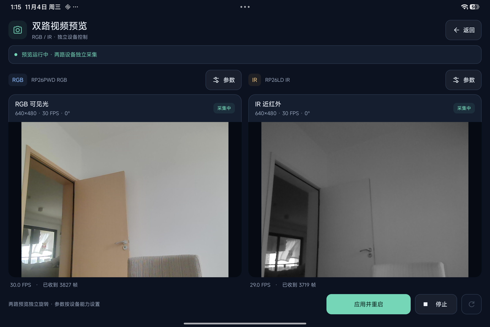

# UVCAndroidCamera

English | [简体中文](README.zh-CN.md)

A trimmed Android USB camera acquisition library maintained by FaceSDKPro, based on
[UVCAndroid](https://github.com/shiyinghan/UVCAndroid).

**We trimmed the upstream repository to support development of [HelloFace](https://github.com/FaceSDKPro/HelloFace)'s RGB + near-infrared (IR) dual-camera face recognition feature.**
This repository provides a standalone Android camera SDK and Demo: concurrent capture, preview, pixel delivery and device lifecycle management.
Face recognition algorithms, liveness policies and cross-camera face association are developed in the HelloFace / SDK integration layer.

## Supported camera topology

The paired capture API targets an **RGB + near-infrared (NIR/IR) camera configuration with two independent UVC devices and two independent video streams**.
The host enumerates the visible-light RGB camera and the near-infrared camera separately. Each has its own device identifier and is opened, configured and captured independently:

- **RGB stream**: one UVC device supplies visible-light images for preview and face detection/recognition in the integration layer.
- **IR stream**: another UVC device supplies genuine near-infrared images for infrared liveness evaluation in the integration layer.

What is commonly described here as “two Camera IDs” means **two separately enumerated Android USB Host `UsbDevice` identities**.
This library accesses UVC devices through USB Host / libusb; it does not use Camera2 `cameraId` values or require Camera2 enumeration.
Bind RGB/IR roles by VID/PID or explicit user configuration, enumerate again after reconnecting, and do not assume enumeration order or persistent device identifiers.

**The paired API does not currently support RGB/IR modules that deliver a single video stream**, including side-by-side/top-bottom composite frames
or alternating RGB/IR frames within one stream. Multiple VideoStreaming interfaces within a single USB device are also not yet supported.
Pairing two independent streams is software time association, not proof of hardware-synchronized exposure.

## Dual-camera preview



Captured on the tablet in landscape: visible-light RGB on the left and near-infrared (IR) on the right, from two independent UVC devices.
The screenshot shows dual previews, per-camera settings and observed FPS; recognition and liveness decisions belong to the integration SDK.

## SDK and Demo delivery

The local SDK version is **0.3.0**, prepared for HelloFace SDK integrators. HelloFace has not been modified or linked.

```sh
./gradlew prepareSdk
```

Local builds, unit tests, Lint and artifact audits produce `build/sdk/uvc-android-camera-0.3.0.zip`:
an AAR, sources JAR, local Maven repository, installable Demo, standalone binary-consuming Demo source and checksums.
No remote publication or CI/CD is executed. See [SDK integration](docs/SDK_INTEGRATION.md) for dependencies and full examples.

- `DualCameraSession`: RGB NV21 + IR GRAY8, RGB preview, bounded buffers and serial frame-pair delivery.
- `Nv21Planes`: direct Y/U/V buffer views for an algorithm SDK, without a Bitmap/I420 round trip.
- Independent RGB/IR capture resolution, FPS and clockwise 0/90/180/270-degree rotation; the Demo applies changes with a controlled restart.
- `FrameTransforms` rotates NV21/NV12/GRAY8 into existing pool buffers; `PreviewTransform` provides aspect-preserving TextureView rotation.
- Failure or detach on either camera ends both streams. Retry explicitly after cleanup; there is no single-camera fallback.
- Pairing uses callback arrival times: software association proves neither simultaneous exposure, face correspondence nor liveness.

Upstream source baseline: `fcdae5f9a194e2111d57019176b53470a120415b`.

The library retains concurrent independent USB devices, one preview surface per camera, headless capture,
pixel callbacks, standard UVC controls, queued permission requests and attach/detach notifications.
Photo storage, video/audio recording, encoders, Java OpenGL multi-output rendering and legacy demos have been removed.
There are no third-party Java runtime dependencies. The manifest declares only CAMERA permission and USB Host capability.
See [UPSTREAM.md](docs/UPSTREAM.md) for the trimming analysis (Chinese).

## Optimizations and measurements

The capture pipeline reduces decoding, memory copies and thread handoffs for continuous HelloFace RGB + IR acquisition:

- **Direct YUYV to NV12/NV21**: ARM NEON preserves source luma without an RGBX round trip; the conversion kernel needs no scratch buffer.
- **Direct MJPEG preview decoding into the Surface**: uses its actual stride, removing the intermediate RGBX frame and full-frame copy in preview-only mode.
- **One fewer headless thread handoff**: decode when the consumer is ready and retain only the latest input instead of processing stale JPEGs.
- **Lower ongoing overhead**: reuse decoders and frame buffers, share the USB/command worker, retain native SIMD and exclude unused encoding/scaling modules. Pixel rotation uses a separate small native kernel.

The capture-path version `c0d095c` was measured on a Xiaomi 24091RPADC (Android 16) with RGB/IR cameras: dual 640×480 YUYV capture requested at 15 FPS per camera and fixed 10 ms exposure reduced
**mean process CPU time per delivered frame from 28.30 ms to 25.46 ms, about 10%**, with slightly higher achieved throughput.
That version's full comparison contains 60 samples. MJPEG scenario ranges overlap; electrical power has not been measured.
See [performance records](docs/PERFORMANCE.md) for conditions, achieved FPS and results.

Current NDK 29 build sizes:

| Item | Bytes |
|---|---:|
| 20 `.so` libraries across four ABIs, uncompressed total | 1,893,020 |
| 10 `.so` libraries across the two ARM ABIs, uncompressed total | 868,816 |
| SDK 0.3.0 four-ABI Release AAR, ZIP archive | 926,034 |

Per-library budgets and the **1,900,000-byte** native payload ceiling remain enforced.
All 20 libraries pass **16 KB ELF alignment**, and the sample APKs pass **16 KB ZIP alignment**.
Runtime validation on a 16 KB page-size device remains outstanding. See [NATIVE_BUILD.md](docs/NATIVE_BUILD.md) for toolchain/runtime choices and checks.

## Build

Use JDK 17, Android SDK 36 and NDK `29.0.14206865`. The Gradle Wrapper is pinned to `8.14.3`.
The library supports Android 5.0+; the sample requires Android 6.0+.
Four ABIs are included: arm64-v8a, armeabi-v7a, x86 and x86_64.

```sh
./gradlew :camera:assembleRelease :camera:testReleaseUnitTest :sample:assembleRelease
python3 tools/check_artifact.py camera/build/outputs/aar/camera-release.aar --apk sample/build/outputs/apk/release/sample-release-unsigned.apk
```

Native settings match HiFace's NDK 29, C++17, ThinLTO, stack protection and RELRO/NOW/NX; codec SIMD is retained.
API 21 library compatibility and x86 emulator support remain available. For HelloFace/HiFace ARM-only integration:

```sh
./gradlew :camera:assembleRelease -PuvcAbis=arm64-v8a,armeabi-v7a
python3 tools/check_artifact.py camera/build/outputs/aar/camera-release.aar --abis arm64-v8a armeabi-v7a
```

The lightweight `system` C++ runtime provides basic new/delete; STL objects and exceptions do not cross libraries. See [native build notes](docs/NATIVE_BUILD.md) for the rationale and future migration constraints.
The artifact audit checks permissions, native exports, dependencies, size, ELF/APK alignment and matching native bytes between the APK and AAR.

An explicit Google Maven mirror can be supplied when needed:

```sh
./gradlew :camera:assembleRelease -PgoogleMavenMirror=https://maven.aliyun.com/repository/google
```

The default repositories are Google Maven and Maven Central. JCenter, JitPack and upstream publishing account configuration are not used.
Build outputs stay in each module's `build/` directory. AARs, APKs, native binaries and local signing material are excluded from source control.

## Integration

Add the `camera` module to your project, or build and consume the AAR locally.
`com.facesdkpro:uvc-android-camera:0.3.0` is this project's local publication coordinate; it has not been published to Maven Central.
To publish to your local Maven repository, run `./gradlew :camera:publishReleasePublicationToMavenLocal`.

```java
UvcCameraManager manager = new UvcCameraManager(context, new UvcCameraManager.Listener() {
    @Override public void onOpened(UvcCameraManager.Camera camera) { }
    @Override public void onError(UsbDevice device, String message, Throwable cause) { }
});

// Obtain CAMERA runtime permission first, then select devices from manager.devices().
// Bind RGB/IR roles by VID/PID or user selection, never by enumeration order.
UvcCameraManager.Camera rgb = manager.open(rgbDevice, StreamConfig.defaults(), rgbSurface,
        (camera, frame) -> {
            ByteBuffer pixels = frame.pixels(); // Borrowed, read-only direct NV21 buffer.
            // Consume synchronously here; call frame.copyPixels() to retain an owned copy.
        });
StreamConfig irConfig = new StreamConfig(640, 480, 30,
        UVCCamera.UVC_VS_FRAME_MJPEG, UVCCamera.PIXEL_FORMAT_GRAY8, 0);
UvcCameraManager.Camera ir = manager.open(irDevice, irConfig, null,
        (camera, frame) -> {
            ByteBuffer gray8 = frame.luma(); // Packed GRAY8; use a bounded copyLumaTo pool for async work.
        });

rgb.withControls(control -> {
    if (control.isBrightnessEnable()) control.setBrightnessPercent(50);
});

// Stop delivery when leaving the screen. Native cleanup runs on the command thread.
// onShutdown signals that cleanup has completed.
manager.close();
```

`StreamConfig.defaults()` explicitly selects **640×480, MJPEG, 30 FPS and NV21 callbacks**.
Unsupported resolutions or frame rates fail instead of silently selecting a larger mode.
Device-provided YUYV input can also be selected.
Callbacks support YUYV, NV12, NV21, RGB, RGB565, RGBX, BGR and GRAY8. RAW means decoded YUYV here,
not compressed MJPEG bytes. Low-level `UvcCameraManager` callbacks retain capture orientation; paired `FramePair` pixels
are physically rotated as configured, swapping width/height for quarter turns. Neither API automatically mirrors or detects faces.

### Resolution, frame rate and rotation

`StreamConfig(width, height, fps, frameType, pixelFormat, quirks)` selects each exact UVC capture request.
`DualCameraConfig.withRotations(rgbDegrees, irDegrees)` sets independent pixel rotations for paired delivery.
Surface previews retain capture orientation; apply `PreviewTransform.fitCenter(...)` / `centerCrop(...)` to the host TextureView.
Close the previous session and wait for `onClosed` before opening with new settings; the Demo's apply/restart action does this.
Unsupported resolution/transport/FPS combinations fail explicitly without silent fallback. Requested capture FPS, observed FPS and pair-delivery limits are separate.
See [SDK integration](docs/SDK_INTEGRATION.md) for full calls and output-coordinate conventions.

State callbacks run on the main thread. Each camera's frame callbacks run on its native callback thread,
using a queue that retains only the latest frame.
Do not wait for the UI inside a frame callback or retain a borrowed buffer after returning.
Use bounded copying/dropping when passing frames to another thread.
`CameraFrame.arrivalTimeNanos` is the host monotonic callback arrival time, not a sensor timestamp or proof of hardware synchronization.

Each session corresponds to one independent USB device, and multiple sessions can run concurrently.
Multiple VideoStreaming interfaces within a single USB device require additional adaptation and are outside the current multi-camera contract.
Attach/detach events notify the host. Detaching closes the corresponding session; after reattachment, the host selects and reopens the appropriate role.
IR face boxes, cross-camera face association and liveness algorithms belong to the upper SDK layer.

## Lower-power integration and pixel semantics

- Use preview-only sessions for display. Add a FrameListener for SDK pixel consumption, and attach a Surface only to cameras that need to be shown.
- Select `PIXEL_FORMAT_GRAY8` for headless IR analysis when the SDK accepts its range. Headless MJPEG produces packed full-range grayscale (`width * height` bytes); with a preview, grayscale reuses the required RGBX display frame.
- Borrow luma synchronously with `frame.luma()`, or copy into reusable arrays with `copyLumaTo(byte[], offset)` / `copyPixelsTo(byte[], offset)`. Keep asynchronous queues bounded; borrowed views expire on callback return.
- Choose a supported resolution/FPS for the workload and close unused sessions. Host-side dropping does not reduce camera USB traffic, sensor consumption or IR illumination power.

**YUYV pixel semantics**: direct NV12/NV21 preserves source Y and vertically averages chroma; GRAY8 preserves source Y with or without a preview.
Values can differ from the old YUYV→RGBX→NV round trip. MJPEG NV12/NV21 keeps its prior color conversion; directly decoded JPEG GRAY8 is not guaranteed to equal that NV21 Y plane either.
Use the actual input range when integrating an SDK. See [PERFORMANCE.md](docs/PERFORMANCE.md) for details.

`UvcCameraManager` defaults to USB broadcasts plus a five-second fallback scan.
`new UvcCameraManager(context, listener, devicePollMillis)` accepts `0` for broadcasts plus the initial scan, or an interval of at least 1000 ms.
Verify attach broadcasts on the target system before disabling polling; when broadcasts are missing, discovery latency follows the configured interval.

## Sample and device validation

On 2026-11-04, the tablet and RGB/IR cameras above passed 59 device checks, 24 dual-camera mode cases and 10 transition phases.
Another 120 YUYV numerical combinations and six JPEG stride/error-recovery groups passed. All 59 resource checks passed again after performance measurements.
Subsequent global review adds JNI reentrancy/reference, allocation-failure, USB-submission and RGBX stride-boundary checks. See [VALIDATION.md](docs/VALIDATION.md) for the complete evidence scope (Chinese).

`sample` opens the SDK Demo by default: explicit RGB/IR selection, independent resolution, capture FPS, MJPEG/YUYV and rotation settings,
a dark dashboard with RGB preview, rotated NV21/GRAY8 dimensions, observed capture FPS, pair rate and callback-arrival skew, with headless IR.
Wide layouts place preview and settings side by side; narrow layouts stack them. Settings scroll independently when space allows; compact portrait screens scroll the full dashboard. Start/stop controls stay at the bottom. Blue RGB and amber IR accents distinguish channels, with a separate connection/error banner.
`SdkDemoActivity.consumePair()` is the synchronous algorithm integration point; it validates pixels without simulating recognition or liveness.
The top dual-preview button opens a screen with two TextureViews. Each channel has a settings dialog for device selection, independent resolution/FPS/transport/preview rotation and brightness where supported. This screen is preview-only and shows observed FPS and frame counts.
Narrow or compact landscape screens scroll the preview cards so both streams retain a full image area.
Selected settings survive screen rotation; acquisition stops with the Activity lifecycle and must be restarted manually. The interface uses native Android Views and vector resources with no added UI framework dependency.
Both screens share device selection restored by USB identity; cancelling a settings dialog does not rely on list positions that may change after hotplug.
On stop, failure or apply/restart, the dual-preview screen waits for the manager's `onShutdown` before releasing retired Surfaces or creating a replacement manager. Stale callbacks cannot update a new session.
Statistics timers run only during capture sessions, and unchanged text/preview states are not reapplied. The dual-preview screen keeps the display awake only during capture and retains preview-only sessions without unused NV21 conversion.
The installable `demo` build uses the local standard debug identity and R8, without diagnostic Activities.
`deviceTest` is a separate acceptance build using Release optimization and JNI keep rules, signed with the local Debug identity.
Its diagnostic Activity is excluded from the production `release` build.

```sh
./gradlew :sample:assembleDeviceTest
python3 tools/run_device_checks.py --serial YOUR_ADB_SERIAL --output /path/outside/repository
```

The device must allow installation, CAMERA permission and access to both USB cameras.
The script checks simultaneous headless capture, repeated open/close, error recovery, buffer/GRAY8 contracts,
device parameter reads, both preview updates and resource cleanup. It saves statistics and logs, not camera images.
File descriptors are recorded by category, including USB, events, pipes and graphics, so Android graphics buffer caches are not mistaken for capture connection leaks.
Physical hotplug, long-duration reliability, hardware synchronization and operation on a 16 KB page-size device require separate validation.
Short capture tests and ELF alignment checks do not replace those tests. See [VALIDATION.md](docs/VALIDATION.md) for the recorded validation scope (Chinese).

## Project layout and documentation

- `camera/`: camera SDK; `sample/`: demonstration and device acceptance entry points.
- `docs/`: topic guides and README images; `tools/`: local audit, acceptance and packaging tools.
- The root keeps bilingual READMEs, licenses, collaboration instructions and required Gradle configuration. Unless noted otherwise, run commands from the project root.

| Document | Contents |
|---|---|
| [SDK integration](docs/SDK_INTEGRATION.md) | AAR setup, RGB/IR frame contracts, rotation and lifecycle |
| [Native build](docs/NATIVE_BUILD.md) | NDK, ABIs, size budgets and 16 KB alignment |
| [Performance records](docs/PERFORMANCE.md) | Comparison conditions, pixel semantics and measurements |
| [Upstream trimming analysis](docs/UPSTREAM.md) | Retained/removed features and implementation choices (Chinese) |
| [Validation records](docs/VALIDATION.md) | Historical candidates, device results and unexecuted scope (Chinese) |

## Origin and licenses

The Java/JNI adapter retains Apache-2.0 licensing, original copyright notices and modification notes.
libusb, libuvc, libjpeg-turbo, libyuv and RapidJSON retain their respective licenses; see [NOTICE](NOTICE),
the license files in the source tree and `META-INF/uvccamera/LICENSES/` inside the AAR.
This project uses a new, trimmed management API. Remove the old upstream dependency when migrating to avoid packaging duplicate JNI libraries and low-level classes.
