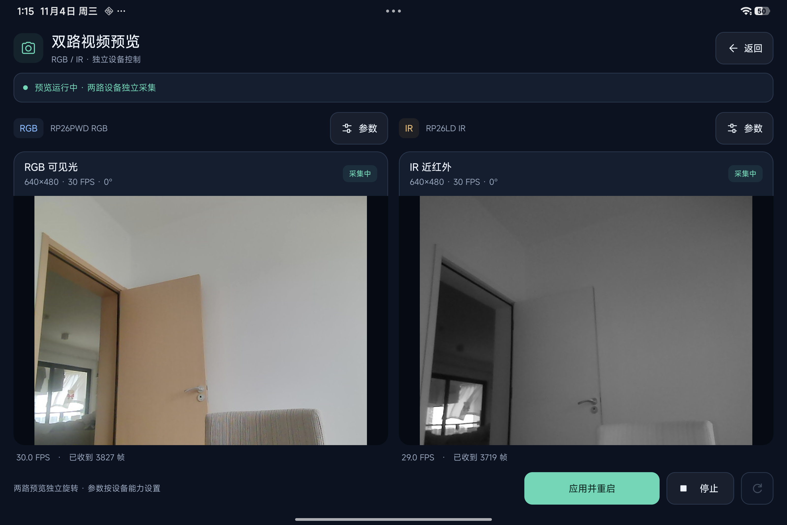

# UVCAndroidCamera

[English](README.md) | 简体中文

由 FaceSDKPro 基于 [UVCAndroid](https://github.com/shiyinghan/UVCAndroid) 裁剪维护的 Android USB 摄像头采集库。

**我们将上游仓库裁剪后，用于 [HelloFace](https://github.com/FaceSDKPro/HelloFace) 的 RGB + 近红外（IR）双目人脸识别功能开发。**
本仓库提供可独立引入的 Android 摄像头 SDK 与配套 Demo：双路采集、预览、像素送帧和设备生命周期管理。
识别算法、活体策略和双路人脸关联在 HelloFace / SDK 接入层开发。

## 支持的摄像头类型

本项目的双目采集接口面向 **RGB + 近红外（NIR/IR）双光谱双摄方案：两个独立 UVC 设备、两路独立视频流**。
主机分别枚举可见光 RGB 摄像头与近红外摄像头，每路具有独立的设备标识，分别打开、配置和采集：

- **RGB 路**：一个 UVC 设备，输出一路可见光画面，用于预览及上层人脸检测、识别。
- **IR 路**：另一个 UVC 设备，输出一路真实近红外画面，用于上层红外活体评估。

这里通常所说的“两个 Camera ID”，准确地说是 **Android USB Host 枚举出的两个 `UsbDevice` 标识**。
本库直接通过 USB Host / libusb 访问 UVC 设备。RGB/IR 角色按 VID/PID 或用户配置绑定。

**当前双目接口不支持单视频流输出的 RGB/IR 模组**，包括将两幅画面左右/上下拼接到同一帧、
或在同一路流中交替输出 RGB/IR 的设备；同一 USB 设备内的多个 VideoStreaming 接口也尚未适配。
两路独立视频流的帧配对属于软件时间关联，不代表硬件同步曝光。

## 双目预览



平板横屏实拍：左侧为 RGB 可见光，右侧为近红外（IR），来自两个独立 UVC 设备。
截图展示双路预览、独立参数入口及实际帧率；识别与活体判断由上层 SDK 实现。


## 接入

将 `camera` 模块加入项目，或在本机构建并使用 AAR。
`com.facesdkpro:uvc-android-camera:0.3.0` 是本工程的本地发布坐标，尚未发布到 Maven Central。
需要本地 Maven 时运行 `./gradlew :camera:publishReleasePublicationToMavenLocal`。

```java
UvcCameraManager manager = new UvcCameraManager(context, new UvcCameraManager.Listener() {
    @Override public void onOpened(UvcCameraManager.Camera camera) { }
    @Override public void onError(UsbDevice device, String message, Throwable cause) { }
});

// 在应用中先取得 CAMERA 运行时权限，再从 manager.devices() 选择设备。
// RGB/IR 的角色由 VID/PID 或用户选择绑定，不能依赖列表顺序。
UvcCameraManager.Camera rgb = manager.open(rgbDevice, StreamConfig.defaults(), rgbSurface,
        (camera, frame) -> {
            ByteBuffer pixels = frame.pixels(); // 只在回调期间有效的 DirectByteBuffer，只读 NV21。
            // 在这里同步消费；若要异步保留，显式调用 frame.copyPixels()。
        });
StreamConfig irConfig = new StreamConfig(640, 480, 30,
        UVCCamera.UVC_VS_FRAME_MJPEG, UVCCamera.PIXEL_FORMAT_GRAY8, 0);
UvcCameraManager.Camera ir = manager.open(irDevice, irConfig, null,
        (camera, frame) -> {
            ByteBuffer gray8 = frame.luma(); // 紧凑 GRAY8；异步处理时用有界数组池配合 copyLumaTo。
        });

rgb.withControls(control -> {
    if (control.isBrightnessEnable()) control.setBrightnessPercent(50);
});

// 页面离开时停止送帧；原生资源在命令线程释放，onShutdown 表示清理结束。
manager.close();
```

`StreamConfig.defaults()` 明确选择 **640×480、MJPEG、30 FPS、NV21 回调**。
不支持的分辨率/帧率会失败，不会静默改为更大的模式。输入格式也可选择设备提供的 YUYV。
回调支持 YUYV、NV12、NV21、RGB、RGB565、RGBX、BGR、GRAY8；RAW 在此表示解码后的 YUYV，
不是压缩 MJPEG 字节。低层 `UvcCameraManager` 回调保留采集方向；双目 `FramePair` 按配置实际旋转像素，
90°/270° 时输出宽高交换。均不自动镜像或做人脸检测。

### 分辨率、帧率与旋转

`StreamConfig(width, height, fps, frameType, pixelFormat, quirks)` 设置每路实际 UVC 采集请求；
`DualCameraConfig.withRotations(rgbDegrees, irDegrees)` 设置双目回调的独立像素旋转。
预览 Surface 保持采集方向，宿主使用 `PreviewTransform.fitCenter(...)` / `centerCrop(...)` 对 TextureView 做显示变换。
应用新配置时先关闭旧会话，等待 `onClosed` 再重新打开；Demo 的“应用并重启”已执行这一步骤。
设备不支持的分辨率/格式/FPS 组合会明确失败，不会静默降级。采集 FPS、实际观测 FPS 与帧对交付上限分别显示。
完整调用和输出坐标约定见 [SDK 接入说明](docs/SDK_INTEGRATION.zh-CN.md)。

状态回调在主线程；每路帧回调在该摄像头的原生线程，采用只保留最新帧的队列。
回调内不要等待 UI，也不要在保留借用 Buffer 后返回；需要跨线程时自行有界复制/丢帧。
`CameraFrame.arrivalTimeNanos` 是主机单调时钟的回调到达时间，不能当作传感器时间戳或硬件同步证明。

一个会话对应一个独立 USB 设备，可同时开多个会话。单个 USB 设备内多个 VideoStreaming 接口
需要额外适配，不在当前多摄契约内。插拔会通知宿主；拔出关闭对应会话，重新插入后由宿主按角色重新选择。
IR 人脸框、双路同人关联及活体算法由上层 SDK 管理。

## 低功耗接入与像素约定

- 只需要显示时使用纯预览会话；需要 SDK 像素时再传入 FrameListener，只给需要显示的摄像头设置 Surface。
- IR 不需要预览且 SDK 接受对应灰度范围时，选择 `PIXEL_FORMAT_GRAY8`。无预览 MJPEG 直接输出 `width * height` 字节的全范围灰度；有预览时复用显示所需的 RGBX 帧生成灰度。
- 用 `frame.luma()` 同步借用亮度，或用 `copyLumaTo(byte[], offset)`、`copyPixelsTo(byte[], offset)` 复制到复用数组；异步队列保持有界，借用视图只在回调期间有效。
- 按业务选择设备支持的分辨率/帧率，不使用时关闭会话。主机丢帧不会降低相机 USB 流量、传感器或红外补光功耗。

**YUYV 的像素值约定**：NV12/NV21 直转保留源 Y，并对相邻两行色度平均；GRAY8 无论有无预览都保留源 Y。
这些数值与旧的 YUYV→RGBX→NV 绕行结果可能不同。MJPEG 的 NV12/NV21 仍使用原颜色转换；JPEG 直接 GRAY8 也不保证等于该 NV21 的 Y。
接入 SDK 时按实际输入范围使用像素；详细说明见 [PERFORMANCE.zh-CN.md](docs/PERFORMANCE.zh-CN.md)。

`UvcCameraManager` 默认使用 USB 广播与五秒一次的兜底扫描。
`new UvcCameraManager(context, listener, devicePollMillis)` 可设为 `0`（仅广播及首次扫描），或至少 1000 毫秒的间隔。
关闭轮询前应确认目标系统插入广播可靠；缺少广播时，发现延迟取决于轮询间隔。

## 示例与设备验收

`sample` 默认进入 SDK Demo：明确选择 RGB/IR，每路独立设置分辨率、采集 FPS、MJPEG/YUYV 和旋转角度；
深色面板显示 RGB 预览、旋转后的 NV21/GRAY8 宽高、实际采集 FPS、帧对速率及回调到达时间差，IR 无预览。
横屏采用预览与设置并排布局，窄屏采用上下布局；空间充足时参数区独立滚动，紧凑竖屏支持整页滚动，开始/停止按钮固定在底部。RGB 蓝色、IR 琥珀色用于区分通道，连接状态和错误独立显示。
`SdkDemoActivity.consumePair()` 是算法同步接入位置；当前只检查像素契约，不模拟识别或活体结果。
顶部“双路预览”进入两个 TextureView 的预览页；每路“参数”弹窗提供设备选择、独立分辨率/FPS/传输格式/预览旋转及设备支持的亮度控制。该页面只预览，并显示实际帧率和累计帧数。
窄屏或紧凑横屏可滚动浏览预览卡片，保证两路画面均有完整的显示区域。
页面旋转后保留已选参数，采集按原生命周期停止，需要手动重新打开。界面使用 Android 原生 View 和矢量资源，没有增加 UI 框架依赖。
两个页面共用按 USB 身份恢复的设备选择逻辑；参数弹窗取消时不依赖可能因插拔变化的列表下标。
双预览页停止、失败和应用重启时统一等待管理器 `onShutdown`，之后才释放旧 Surface 或创建新管理器；旧回调不能更新新会话。
统计定时器只在采集会话中运行，相同文字和预览状态不重复更新；双预览页仅采集时保持亮屏，纯预览仍不做无用的 NV21 转换。
`demo` 为使用本机标准 Debug 签名、启用 R8 且不带诊断 Activity 的可安装演示构建。
`deviceTest` 是使用 Release 优化和 JNI 保留规则、以本机 Debug 身份签名的独立验收构建；
其中的诊断 Activity 不进入正式 `release`。

```sh
./gradlew :sample:assembleDeviceTest
python3 tools/run_device_checks.py --serial YOUR_ADB_SERIAL --output /path/outside/repository
```

设备需要允许安装、CAMERA 和两路 USB 访问。脚本验证双路无预览出帧、反复开关、错误恢复、
Buffer/GRAY8 契约、设备参数读取、两路预览更新及资源释放，只保存统计和日志，不保存图像。
文件描述符按 USB/事件/管道/图形等类型分别记录，避免将 Android 图形缓冲缓存误判为采集连接泄漏。
物理拔插、长期稳定性、硬件同步及 16 KB 真机运行需分别验收，不能由短时采集或 ELF 对齐检查代替。验收记录见 [VALIDATION.md](docs/VALIDATION.md)。

## 工程目录与文档

- `camera/`：摄像头 SDK；`sample/`：演示与设备验收入口。
- `docs/`：专题文档与 README 配图；`tools/`：本地审计、验收和打包工具。
- 根目录保留中英文 README、许可证、协作约定和必要的 Gradle 构建配置；未另行注明时，命令从工程根目录执行。

| 文档 | 内容 |
|---|---|
| [SDK 接入](docs/SDK_INTEGRATION.zh-CN.md) | AAR 引入、RGB/IR 帧契约、旋转与生命周期 |
| [原生构建](docs/NATIVE_BUILD.md) | NDK、ABI、体积预算与 16 KB 对齐 |
| [性能记录](docs/PERFORMANCE.zh-CN.md) | 对照条件、像素语义和测量结果 |
| [上游裁剪分析](docs/UPSTREAM.md) | 保留/删除的功能及实现取舍 |
| [验收记录](docs/VALIDATION.md) | 历史候选、真机结果和未执行范围 |

