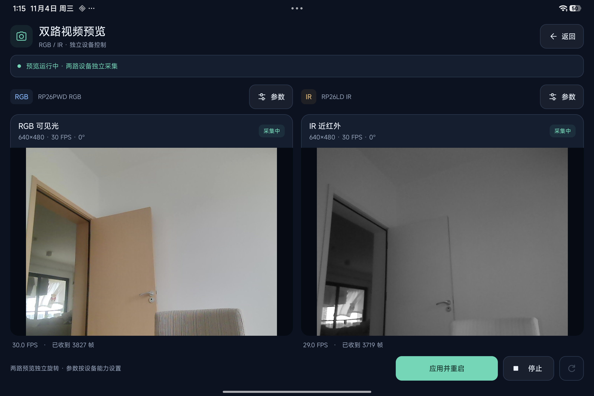
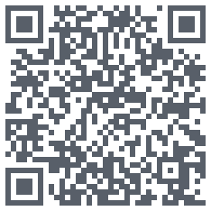

# UVCAndroidCamera

[English](../README.md) | 简体中文

基于 [UVCAndroid](https://github.com/shiyinghan/UVCAndroid) 裁剪的 Android USB 摄像头 SDK 与 Demo，用于 [HelloFace](https://github.com/FaceSDKPro/HelloFace) 的 RGB + 近红外（IR）双目人脸识别功能开发。人脸识别和活体判断由上层算法 SDK 实现。

## 支持的摄像头

面向 **RGB + IR 两个独立 UVC 设备、两个 USB 设备标识、两路独立视频流**。RGB/IR 角色按 VID/PID 或用户配置绑定。

不支持一路拼接或交替输出 RGB/IR 的模组；同一 USB 设备内的多路视频接口尚未适配。软件帧配对不代表硬件同步曝光。

## 双目预览



左侧为 RGB 可见光，右侧为近红外（IR）。每路可独立设置分辨率、帧率、MJPEG/YUYV 和 0°/90°/180°/270° 旋转，参数组合以设备支持为准。

## 主要功能

- 双路预览、原始帧回调，RGB NV21 与 IR GRAY8 帧对交付。
- USB 权限、热插拔、设备控制及会话生命周期管理。
- 有界缓冲、只保留最新帧；一路失败时结束双路采集。

## 接入

SDK 支持 Android 5.0+（API 21），Demo 要求 Android 6.0+（API 23）。将 `UVCCamera` 模块加入工程，或使用构建生成的 AAR：

```gradle
implementation project(':UVCCamera')
```

详细调用和构建步骤见 [SDK 接入说明](SDK_INTEGRATION.zh-CN.md)；原生配置见 [构建说明](NATIVE_BUILD.md)。

## APK 下载

[下载 APK](https://www.helloface.dev)


